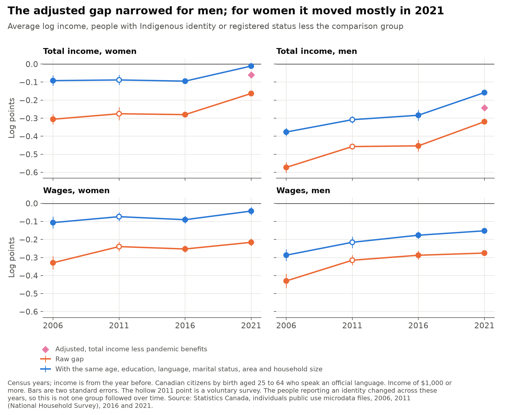
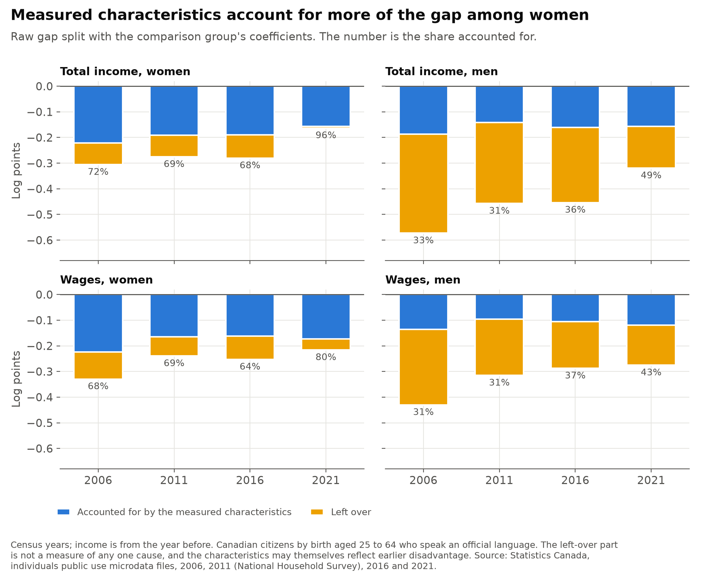
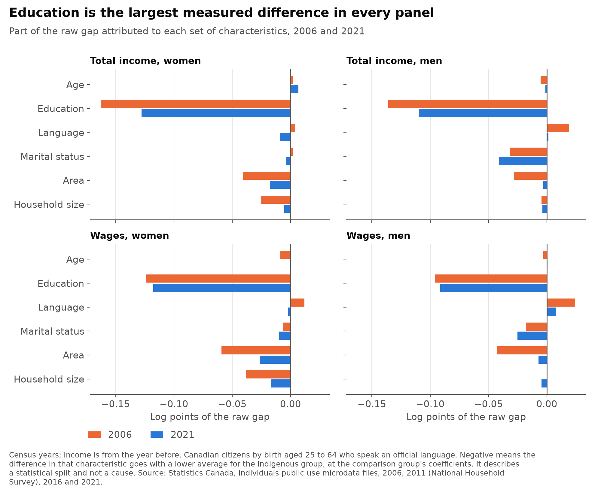
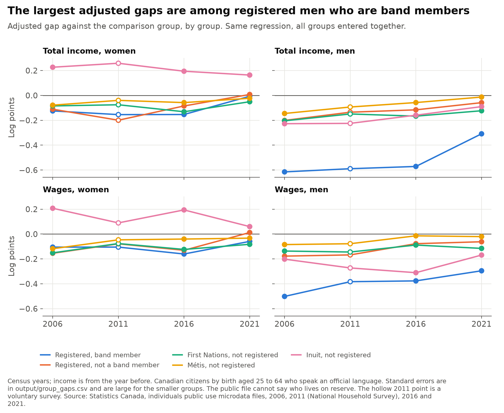
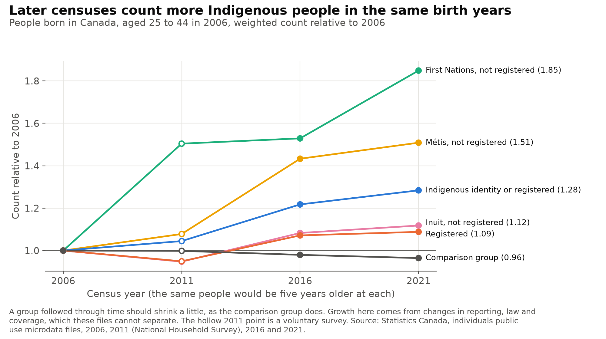

# canada_indigenous_income_gap

[](https://github.com/atamalfuzi/canada_indigenous_income_gap/actions/workflows/tests.yml)

How the gap in income and wages between Indigenous and non-Indigenous Canadians with the same observed characteristics changed across four census years: 2006, 2011, 2016 and 2021. Income is from the year before each census. Python, with pandas and NumPy, on Statistics Canada's public use microdata files.

This started as an assignment in a graduate applied econometrics course at Simon Fraser University, which applied the approach of Pendakur and Pendakur (2011) to the 2006 Census. Here the 2006 regressions are reproduced in Python and the work is extended to the later files.

> **Personal project.** This is my own analysis of publicly available data. It is not associated with my work for any current or past employer and does not represent their views.

The results describe a gap and what it is correlated with in these files. They do not identify causes. Nothing here measures the abilities, habits or culture of any group.

| Question | Methods | Answer |
|---|---|---|
| [Does the 2006 work reproduce?](#1-does-the-2006-work-reproduce) | The A1b regressions, OLS with robust errors | Closely. All 32 coefficients are within 0.35 of a standard error, but the sample differs by 0.7% for a reason I could not trace. |
| [How did the gap change?](#2-how-did-the-gap-change) | Weighted OLS by sex and year, replicate-weight errors | For men the adjusted wage gap went from −0.287 to −0.152 log points. For women it went from −0.107 to −0.043, most of it in 2021. |
| [What do observed characteristics account for?](#3-what-do-observed-characteristics-account-for) | Oaxaca-Blinder decomposition | Roughly a third to a half of the gap among men and roughly 60% or more among women. Education is the largest part. |
| [Who does the average cover?](#4-who-does-the-average-cover) | The A1b indicators, by group | Gaps differ widely. They are largest among registered men who are band members. |
| [How much is 2021 a pandemic result?](#5-how-much-is-2021-a-pandemic-result) | Total income less pandemic benefits | For men, 0.085 of the 0.126 narrowing in total income from 2016 to 2021 goes away when benefits are taken out. |
| [Are these the same people over time?](#6-are-these-the-same-people-over-time) | Counts of the same birth years, and a what-if | No. The same birth years count 28% more Indigenous people in 2021 than in 2006, while the comparison group shrinks 4%. |

## The main limit

**The people counted as Indigenous changed between these files, so this series is not one group followed over time.** Some people report an Indigenous identity in one census and not in the next. Laws on registered status changed, and so did the question wording and which communities were enumerated. A linked Statistics Canada study found that 24.6% of the 2016 Aboriginal identity population had reported as non-Aboriginal in 2011, and that 83.2% of those who reported an Aboriginal identity in 2011 still did so in 2016 (O'Donnell and LaPointe 2019). These files cannot link people across years. So a narrower gap could reflect changes in income, changes in who reports, or both. [Section 6](#6-are-these-the-same-people-over-time) measures the net change and shows what it could do to the results.

The left-over part of the gap is not a measure of any one cause. It can include characteristics the files do not measure, time worked, location within the broad areas used here, tax treatment, measurement differences and discrimination. These data cannot separate them.

## What it shows

All results are for Canadian citizens by birth aged 25 to 64 who speak English or French, with $1,000 or more of the income in question. The Indigenous group has an Indigenous identity or registered status. The comparison group has neither, and no Indigenous-only ancestry response. Gaps are in log points, the Indigenous group less the comparison group, so negative means lower. A gap of −0.15 is about 14% lower.

Numbers in brackets are standard errors.

### 1. Does the 2006 work reproduce?

A1b ran OLS of log total income and log wages, for women and men separately, with robust errors and no weights. The sample steps match the A1b log exactly through the income floor: 175,179 dropped on citizenship, 314,670 on age, 191 on language and 12,162 on total income below $100.

| | Women, total income | Men, total income | Women, wages | Men, wages |
|---|---:|---:|---:|---:|
| Observations, A1b | 170,701 | 166,896 | 131,361 | 135,727 |
| Observations, here | 171,068 | 169,044 | 131,566 | 137,548 |
| R-squared, A1b | 0.159 | 0.168 | 0.152 | 0.140 |
| R-squared, here | 0.163 | 0.174 | 0.159 | 0.149 |

Across the 32 identity, registration and ancestry coefficients, the largest difference is 0.017 and the largest in standard errors is 0.35. All signs match. The comparison is in `output/reproduction_2006.csv`.

The samples differ after the floor. The A1b log shows 2,667 income values that did not convert to numbers, where the Statistics Canada file has 152 not-available codes in that sample. The difference falls mostly on men. A1b used a copy of the file written from R, which I no longer have. Removing the top-coded records does not produce A1b's numbers, because it lowers the residual variance while A1b's is higher, so I do not know the cause. The code here reads Statistics Canada's file directly.

**A correction to the labels in A1b.** A1b calls two of its groups `reg_on_reserve` and `reg_off_reserve`. They are defined from band membership, so they are registered band members and registered people who are not band members. The public files have no on-reserve variable. Many band members live off reserve, so these results say nothing direct about reserves, and the groups are named accordingly here.

The later years need a model with the same variables in every file, so three things change from A1b: marital status uses the one variable available in all years, detailed origin controls are dropped because the list of origins changes every year, and people with mixed Indigenous ancestry stay in the comparison group because later files do not identify them. On 2006 data these changes move the group coefficients by 0.053 at most (Inuit men, total income). The move for registered band members who are men is from −0.591 to −0.615. Taking mixed ancestry out of the 2006 comparison group moves the pooled gap by 0.002 at most.

### 2. How did the gap change?



| | | 2006 | 2011 | 2016 | 2021 |
|---|---|---:|---:|---:|---:|
| Wages, women | Raw | −0.329 (0.019) | −0.240 (0.013) | −0.253 (0.010) | −0.216 (0.010) |
| | Adjusted | −0.107 (0.017) | −0.074 (0.012) | −0.091 (0.010) | −0.043 (0.011) |
| Wages, men | Raw | −0.430 (0.020) | −0.315 (0.014) | −0.288 (0.012) | −0.275 (0.008) |
| | Adjusted | −0.287 (0.016) | −0.216 (0.016) | −0.177 (0.011) | −0.152 (0.007) |
| Total income, women | Raw | −0.306 (0.014) | −0.275 (0.018) | −0.280 (0.007) | −0.163 (0.006) |
| | Adjusted | −0.092 (0.014) | −0.088 (0.014) | −0.095 (0.007) | −0.011 (0.007) |
| Total income, men | Raw | −0.573 (0.015) | −0.457 (0.008) | −0.453 (0.016) | −0.319 (0.006) |
| | Adjusted | −0.377 (0.012) | −0.308 (0.010) | −0.284 (0.015) | −0.158 (0.006) |

Adjusted means with the same age group, highest qualification, official languages, marital status, area and household size.

Among men, the adjusted wage gap narrowed by 0.135 (0.018) from 2006 to 2021, from about 25% to about 14% lower. Most of that had happened by 2016. Among women, the adjusted wage gap narrowed by 0.064 (0.020), from about 10% to about 4% lower, and the change from 2006 to 2016 alone, 0.016 (0.020), cannot be told apart from zero. For total income, the largest step for both is the last one, which [section 5](#5-how-much-is-2021-a-pandemic-result) looks at.

These results point the same way as Pendakur and Pendakur's later paper, *Indigenous Earnings Convergence*, which uses the full census files in a Research Data Centre and reports earnings gaps falling from 36% to 16% for men and from 16% to 6% for women from 1995 to 2020. Their sample, comparison group and start date differ, so the numbers are not directly comparable.

Annual wages combine pay with time worked. Among people working full-time for 49 weeks or more, the gaps are smaller:

| Adjusted wage gap | 2006 | 2011 | 2016 | 2021 |
|---|---:|---:|---:|---:|
| Women, all with wages | −0.107 | −0.074 | −0.091 | −0.043 |
| Women, full-year, full-time | −0.038 (0.004) | −0.048 (0.015) | −0.018 (0.010) | −0.022 (0.009) |
| Men, all with wages | −0.287 | −0.216 | −0.177 | −0.152 |
| Men, full-year, full-time | −0.127 (0.013) | −0.080 (0.012) | −0.060 (0.011) | −0.063 (0.012) |

More than half of the adjusted wage gap among men is not present among those working full-year, full-time. That is a description of two samples. It does not show that time worked is a matter of choice, since it also depends on what work is available.

### 3. What do observed characteristics account for?



The Oaxaca-Blinder decomposition splits the raw gap into a part from differences in average characteristics, valued at one group's coefficients, and a part left over. The answer depends on whose coefficients are used, so both are shown:

| Share of the raw gap accounted for | | 2006 | 2011 | 2016 | 2021 |
|---|---|---:|---:|---:|---:|
| Wages, women | Comparison group's coefficients | 68% | 69% | 64% | 80% |
| | Indigenous group's coefficients | 62% | 70% | 66% | 78% |
| Wages, men | Comparison group's coefficients | 31% | 31% | 37% | 43% |
| | Indigenous group's coefficients | 49% | 41% | 50% | 54% |
| Total income, women | Comparison group's coefficients | 72% | 69% | 68% | 96% |
| | Indigenous group's coefficients | 59% | 62% | 58% | 78% |
| Total income, men | Comparison group's coefficients | 33% | 31% | 36% | 49% |
| | Indigenous group's coefficients | 48% | 51% | 50% | 58% |



Education is the largest measured part in every case, between −0.09 and −0.16 log points, and it changes little over time for wages. Area and household size account for less in 2021 than in 2006. The part left over shrinks more than the part accounted for: from 2006 to 2021 the left-over part of the wage gap among men narrowed by 0.139 (0.019), while the part accounted for narrowed by 0.015.

A characteristic counted as accounting for part of the gap is not thereby a neutral or settled explanation. Education, area, marital status and household size can themselves reflect earlier disadvantage, including discrimination. The decomposition is a statistical split, and it does not say what would happen if any characteristic changed.

### 4. Who does the average cover?



| Adjusted gap | Wages, women | | Wages, men | |
|---|---:|---:|---:|---:|
| | 2006 | 2021 | 2006 | 2021 |
| Registered, band member | −0.11 (0.03) | −0.06 (0.02) | −0.50 (0.03) | −0.30 (0.02) |
| Registered, not a band member | −0.16 (0.11) | 0.01 (0.04) | −0.18 (0.05) | −0.06 (0.03) |
| First Nations, not registered | −0.15 (0.03) | −0.08 (0.02) | −0.14 (0.03) | −0.12 (0.02) |
| Métis, not registered | −0.12 (0.02) | −0.03 (0.01) | −0.09 (0.02) | −0.02 (0.01) |
| Inuit, not registered | 0.21 (0.10) | 0.06 (0.08) | −0.20 (0.06) | −0.17 (0.08) |

All groups enter one regression, so each gap is against the comparison group. Someone reporting more than one identity has each indicator set, as in A1b. The full table for all years and total income is in `output/group_gaps.csv`.

The gap among registered men who are band members is the largest in every year and for both measures, leaving out the very small "other identity" group. Among women, the same group's gap is close to the others. Inuit women have a positive gap in all years. The area control does not separate the North, which sits in the "rest of Canada" category, so this is not a like-for-like comparison of places.

Because band membership is not residence, these results cannot be read as on-reserve and off-reserve. Pendakur and Pendakur's later paper, which can see residence, finds much less convergence for registered people living on reserve than for others. The narrowing among band members here may come from those living off reserve, and these files cannot show it. As that paper notes, income earned on reserve by registered people can be exempt from income tax, so the same pre-tax income does not mean the same thing for them.

Two groups in the table output should not be read as series. "Other Indigenous identity" has as few as nine people in a cell. "Indigenous ancestry only" is defined differently across years, as the origin lists change, and its sample doubles in 2021.

### 5. How much is 2021 a pandemic result?

Income in the 2021 file is from 2020 and includes federal pandemic benefits. In this sample, 38.7% of Indigenous women had a benefit against 29.1% of the comparison group, and 37.6% of Indigenous men against 28.5%. Benefits were 8.5% and 6.6% of their total income, against 4.5% and 3.1%. Wages do not include benefits, but they do reflect a year of disrupted work.

| Adjusted gap | 2016 | 2021 | 2021 less benefits |
|---|---:|---:|---:|
| Total income, women | −0.095 (0.007) | −0.011 (0.007) | −0.060 (0.009) |
| Total income, men | −0.284 (0.015) | −0.158 (0.006) | −0.243 (0.009) |
| Registered band members, men | −0.571 (0.022) | −0.309 (0.010) | −0.475 (0.017) |

So benefits account for about 0.085 of the 0.126 narrowing in total income among men and about 0.049 of the 0.084 among women. Taking benefits out also removes people whose income falls below $1,000 without them. The 2021 total income figures should not be read as a new level. The wage series is the better guide to the trend, though 2020 was also a disrupted year for work.

### 6. Are these the same people over time?

A birth cohort of people born in Canada should shrink slowly with age. It can grow only through changes in how people answer, in coverage or in the law, or through people returning to Canada. Following those aged 25 to 44 in 2006 across the files:



| Count relative to 2006 | 2011 | 2016 | 2021 |
|---|---:|---:|---:|
| Comparison group | 1.00 | 0.98 | 0.96 |
| Indigenous identity or registered | 1.04 | 1.22 | 1.28 |
| Registered | 0.95 | 1.07 | 1.09 |
| First Nations, not registered | 1.50 | 1.53 | 1.85 |
| Métis, not registered | 1.08 | 1.43 | 1.51 |
| Inuit, not registered | 0.95 | 1.08 | 1.12 |

These counts should fall slightly with age, as the comparison group's do. Instead, by 2021 about a quarter of the Indigenous group in these birth years is a net addition. Part of the registered growth can follow changes in law, including Bills C-31, C-3 and S-3 and the recognition of the Qalipu Mi'kmaq First Nation in 2011. Coverage also changed between files, so this is not all response change. Statistics Canada says these influences cannot be separated.

The gap in these same birth years also narrowed. A simple what-if shows how far changed reporting could affect that. Suppose every net addition had the comparison group's income, so that the people who were there at the start carry the entire gap:

| Adjusted gap, same birth years | 2006 | 2021 | 2021 if additions were at the comparison group's level |
|---|---:|---:|---:|
| Wages, women | −0.110 (0.019) | −0.047 (0.017) | −0.063 |
| Wages, men | −0.336 (0.019) | −0.141 (0.016) | −0.187 |
| Total income, women | −0.067 (0.015) | −0.058 (0.009) | −0.077 |
| Total income, men | −0.402 (0.012) | −0.167 (0.011) | −0.222 |

Under that assumption the wage gap among men still narrows, from −0.336 to −0.187, and among women from −0.110 to −0.063. This is not a true bound. It uses net change only, while the linked Statistics Canada study shows that movement in and out is much larger than the net. It also says nothing about the income of those who stopped reporting, who are not observed. And gaps also change with age, so these rows mix ageing with the change over time.

## Other limits

- **2011 is a different kind of source.** The National Household Survey was voluntary, with a final response rate of 68.6%, against 95.7% for the 2021 long form. Its identity counts may be affected by non-response. It is marked with a hollow point in the charts.
- **Coverage of reserves changes.** Incompletely enumerated reserves and settlements number 22 in 2006, 36 in 2011, 14 in 2016 and 63 in 2021. These files have no way to restrict to communities enumerated in every year, as Statistics Canada advises for comparisons over time. Long-form total non-response among people living on reserve was 23.1% in 2021.
- **Income sources changed.** In 2006 and 2011 people could report income on the form or allow linkage to tax records. In 2016 and 2021 income comes only from administrative records. Linkage to any tax or benefit record among people on the reserve and remote questionnaire fell from 82.2% in 2016 to 66.9% in 2021, and unlinked records have all income imputed. This may matter most for registered band members, whose total income gap moved most.
- **People with no income or wages are left out.** Logs need positive amounts. The share with $1,000 or more of wages is lower in the Indigenous group, and that difference did not narrow: 8.0 points among men in 2006 and 9.1 in 2021, and 8.1 and 10.3 among women. Gaps here are among people with wages.
- **Income is rounded and top-coded.** In all four files income is randomly rounded to $1,000, or $10,000 above $100,000, and values rounded to zero become $1. So the $100 floor from A1b works as a $1,000 floor. Top incomes are replaced by group averages.
- **Sex and gender.** The 2021 file has a binary gender variable and no sex variable. Earlier files have sex.
- **The area control is coarse.** It has 11 large metropolitan areas, a group of smaller ones and the rest of Canada. It has no province, North or reserve control.
- **Others left out.** People in institutions, in collective dwellings and those not speaking English or French are excluded, along with anyone not a citizen by birth.
- **Terms.** Statistics Canada's variable is "Registered or Treaty Indian status", a legal term under the Indian Act. I use "registered". Older sources use "Aboriginal", which I keep only in titles and when reporting those sources.
- **Standard errors are approximate.** They use the random groups method in each user guide: 8 groups in 2006 and 2011 and 16 in the later files, with the 2021 adjustment. Eight groups give imprecise estimates of the error itself. Robust regression errors, in `output/sensitivity.csv`, are of similar size and larger on average in 2021, and none of the changes described above depends on the choice.

## Run it

The microdata is not in this repository. `data.py` downloads four zip files, about 460 MB, from Statistics Canada into `data/`.

```bash
python -m venv .venv
```

```bash
.venv/Scripts/pip install -r requirements-dev.txt
```

```bash
.venv/Scripts/python data.py
```

```bash
.venv/Scripts/python estimate.py
```

```bash
.venv/Scripts/python figures.py
```

```bash
.venv/Scripts/pytest
```

On Linux or macOS use `.venv/bin/` in place of `.venv/Scripts/`. The estimation takes a few minutes. Tests need no microdata, other than the checked-in table the reproduction test reads.

| File | What it does |
|---|---|
| `data.py` | Downloads the files, reads each year's layout and puts the codes on one scheme |
| `estimate.py` | Reproduces A1b, then writes the gap, decomposition, group, sensitivity and identity tables to `output/` |
| `figures.py` | Draws the charts in `figures/` |
| `tests/` | Checks code mappings, the regression code against statsmodels, the decomposition's arithmetic, the standard error formula and the reproduction |
| `SITE.md` | Proposed text for a portfolio page |

## Sources

Data, under the [Statistics Canada Open Licence](https://www.statcan.gc.ca/eng/reference/licence). Adapted from Statistics Canada. This does not constitute an endorsement by Statistics Canada of this product. All are listed on the [public use microdata files page](https://www150.statcan.gc.ca/n1/pub/98m0001x/index-eng.htm).

| Year | Source | Catalogue | File |
|---|---|---|---|
| 2006 | Census, individuals file | 95M0028X | [`cen06_ind_95m0028x_part_rec06.zip`](https://www150.statcan.gc.ca/n1/pub/98m0001x/2023001/cen06_ind_95m0028x_part_rec06.zip) |
| 2011 | National Household Survey, individuals file | 99M0001X | [`nhs11_ind_99m0001x_part_enm11.zip`](https://www150.statcan.gc.ca/n1/pub/98m0001x/2023001/nhs11_ind_99m0001x_part_enm11.zip) |
| 2016 | Census, individuals file | 98M0001X | [`cen16_ind_98m0001x_part_rec16.zip`](https://www150.statcan.gc.ca/n1/pub/98m0001x/2023001/cen16_ind_98m0001x_part_rec16.zip) |
| 2021 | Census, individuals file | 98M0001X | [`cen21_ind_98m0001x_part_rec21.zip`](https://www150.statcan.gc.ca/n1/pub/98m0001x/2023001/cen21_ind_98m0001x_part_rec21.zip) |

Files for 1991, 1996 and 2001 are also available. They are not used, since the assignment started at 2006 and their codes would need a separate review.

Comparability notes come from the user guides and reference guides inside each zip, in particular the Indigenous Peoples and Income reference guides for 2021.

- O'Donnell, V. and R. LaPointe (2019). [Response mobility and the growth of the Aboriginal identity population, 2006-2011 and 2011-2016](https://www150.statcan.gc.ca/n1/pub/99-011-x/99-011-x2019002-eng.htm). Statistics Canada, catalogue 99-011-X.
- Pendakur, K. and R. Pendakur (2011). [Aboriginal Income Disparity in Canada](https://ideas.repec.org/a/cpp/issued/v37y2011i1p61-83.html). *Canadian Public Policy* 37(1), 61-83.
- Pendakur, K. and R. Pendakur. [Indigenous Earnings Convergence: Canada 1995 to 2020](https://www.sfu.ca/~pendakur/papers/Indigenous%20Earnings%20Convergence.pdf). Working paper.
- The original assignment: [`Applied Econometrics/A1b`](https://github.com/atamalfuzi/economics_coursework/tree/main/Applied%20Econometrics/A1b) in economics_coursework.

## License

Code is under the MIT License. See [LICENSE](LICENSE).
